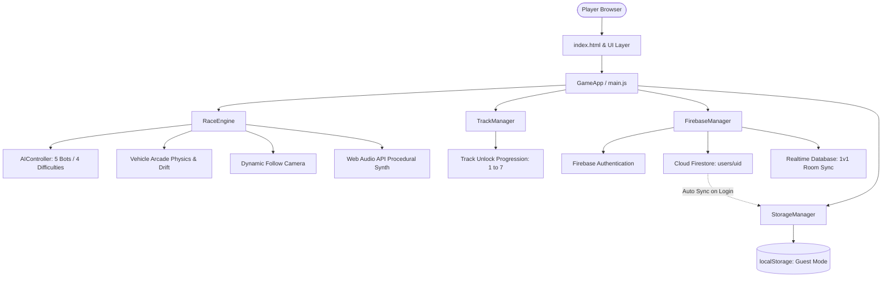

# WORLD RACING CHAMPIONSHIP — SPEED ORDER
### Semi-3D Browser-Based Arcade Racing Game & 1v1 Online Multiplayer

```text
 _________________________________________________________________________________________
|                                                                                         |
|   __      __   ____    _____    _        ____     _____             _____   _____   _   |
|   \ \    / /  / __ \  |  __ \  | |      |  __ \  |  __ \     /\    / ____| |_   _| | \  |
|    \ \  / /  | |  | | | |__) | | |      | |  | | | |__) |   /  \  | |        | |   | |  |
|     \ \/ /   | |  | | |  _  /  | |      | |  | | |  _  /   / /\ \ | |        | |   | |  |
|      \  /    | |__| | | | \ \  | |____  | |__| | | | \ \  / ____ \| |____   _| |_  |_|  |
|       \/      \____/  |_|  \_\ |______| |_____/  |_|  \_\/_/    \_\\_____| |_____| (_)  |
|                                                                                         |
|       🏎️  S  P  E  E  D     O  R  D  E  R     •     A R C A D E     R A C I N G  🏎️     |
|_________________________________________________________________________________________|
```

[](https://threejs.org/)
[](https://vitejs.dev/)
[](https://firebase.google.com/)
[](https://www.netlify.com/)
[](LICENSE)

---

## 🏆 PROJECT HIGHLIGHTS & ARCHITECTURE

**World Racing Championship: Speed Order** is a high-octane semi-3D browser arcade racing game built with **Vanilla JavaScript (ES Modules), HTML5, CSS3, and Three.js (WebGL)**. It incorporates **Firebase Authentication**, **Cloud Firestore** for cross-device cloud progress saving, and **Firebase Realtime Database** for real-time 1v1 online multiplayer.



---

## 🗺️ PROGRESSION: TRACK UNLOCKING SEQUENCE

Initially, **only ONE map is unlocked** (*Goa Marine Drive*). Winning a race on an unlocked track permanently unlocks the next global location in the championship sequence:

```text
[Track 01: GOA MARINE DRIVE] (UNLOCKED BY DEFAULT)
       │ (Win Race)
       ▼
[Track 02: SWITZERLAND MEADOWS]
       │ (Win Race)
       ▼
[Track 03: RUSSIA SNOW FIELDS]
       │ (Win Race)
       ▼
[Track 04: MIAMI NIGHTS]
       │ (Win Race)
       ▼
[Track 05: SCOTLAND HIGHLANDS]
       │ (Win Race)
       ▼
[Track 06: TOKYO DRIFT]
       │ (Win Race)
       ▼
[Track 07: EGYPT DUNES] (CHAMPIONSHIP FINALE)
```

- Locked tracks are visually grayed out with a lock banner (`🔒 LOCKED — WIN PREVIOUS TRACK TO UNLOCK`).
- Winning a race triggers a celebration notification and instantly unlocks the next track across both guest mode and cloud-saved profiles!

---

## 👤 FIREBASE AUTHENTICATION & CLOUD PROGRESS SAVING

Players have the flexibility to:
1. **Play Freely Without Logging In (Guest Mode)**:
   - Full gameplay, track unlocks, car unlocks, and career statistics are saved locally in `localStorage`.
2. **Log In to Cloud-Save Progress**:
   - Supports **Email / Password** and **Google Sign-In**.
   - Automatically merges your local progress with your cloud progress on login.
   - Any newly unlocked cars, newly unlocked tracks, or updated win streaks are automatically synced to Cloud Firestore in real time.
   - Access your garage and unlocked tracks seamlessly from any desktop, laptop, or mobile browser!

### Cloud Progress Schema (`users/{userId}`):
```json
{
  "userId": "225747804383_...",
  "userName": "Racer",
  "email": "racer@domain.com",
  "progress": {
    "selectedCar": "viper_gtr",
    "selectedTrack": "goa_marine",
    "difficulty": "medium",
    "unlockedCars": ["viper_gtr", "apex_turbo", "thunderbolt_s"],
    "unlockedTracks": ["goa_marine", "switzerland", "russia_snow"],
    "streaks": { "easy": 3, "medium": 1, "hard": 0, "legend": 0 },
    "bestStreaks": { "easy": 3, "medium": 1, "hard": 0, "legend": 0 }
  },
  "stats": {
    "totalRaces": 12,
    "totalVictories": 8,
    "totalDefeats": 4,
    "highestSpeed": 268
  },
  "lastCloudSave": "2026-11-24T14:20:00Z"
}
```

---

## 🔒 FIREBASE RULES SETUP

### 1. Cloud Firestore Rules ([firestore.rules](file:///c:/Users/ritam/OneDrive/Desktop/TEMP/firestore.rules))
Go to **Firebase Console** > **Firestore Database** > **Rules** tab, paste the following rules and click **Publish**:

```javascript
rules_version = '2';

service cloud.firestore {
  match /databases/{database}/documents {
    
    // User profile and cloud-saved game progress
    // Only the authenticated user can read and update their own progress
    match /users/{userId} {
      allow read, write: if request.auth != null && request.auth.uid == userId;
    }
    
    // Optional public leaderboard entries
    match /leaderboard/{entry} {
      allow read: if true;
      allow create: if request.auth != null && request.resource.data.userId == request.auth.uid;
      allow update, delete: if false;
    }
    
    match /{document=**} {
      allow read, write: if false;
    }
  }
}
```

### 2. Realtime Database Rules ([database.rules.json](file:///c:/Users/ritam/OneDrive/Desktop/TEMP/database.rules.json))
Go to **Firebase Console** > **Realtime Database** > **Rules** tab, paste the following rules and click **Publish**:

```json
{
  "rules": {
    "rooms": {
      "$roomCode": {
        ".read": "auth != null",
        ".write": "auth != null && (!data.exists() || data.child('hostId').val() === auth.uid || data.child('players').child(auth.uid).exists())",
        "players": {
          "$playerId": {
            ".write": "auth != null && auth.uid === $playerId"
          }
        },
        "status": {
          ".write": "auth != null && data.parent().child('hostId').val() === auth.uid"
        },
        "trackId": {
          ".write": "auth != null && data.parent().child('hostId').val() === auth.uid"
        }
      }
    }
  }
}
```

---

## 🕹️ VEHICLE CATALOG & ATTRIBUTES

| Vehicle Name | Tier | Top Speed | Acceleration | Handling | Braking | Nitro | Unlock Requirement |
| :--- | :--- | :--- | :--- | :--- | :--- | :--- | :--- |
| **Viper GT-R** | Starter | 185 km/h | 26 | 0.88 | 38 | 100 | Default Unlocked |
| **Apex Turbo GT** | Sports | 215 km/h | 30 | 0.92 | 42 | 110 | Default Unlocked |
| **Thunderbolt S** | Rare | 235 km/h | 34 | 0.94 | 45 | 125 | **Win 3 in a row on EASY** |
| **Monza V12 Stradale** | Rare | 260 km/h | 37 | 0.96 | 48 | 130 | **Win 3 in a row on MEDIUM** |
| **Phantom RS Cyber** | Supercar | 285 km/h | 42 | 0.98 | 52 | 145 | **Win 3 in a row on HARD** |
| **Hyperion Chrono X** | Legendary | 315 km/h | 46 | 1.00 | 58 | 160 | **Win 3 in a row on LEGEND** |

---

## ⌨️ CONTROLS

| Action | PC Keyboard | Mobile / Tablet Touch |
| :--- | :--- | :--- |
| **Accelerate** | `W` or `Up Arrow` | `GAS` Button |
| **Brake / Reverse** | `S` or `Down Arrow` | `BRAKE` Button |
| **Steer Left** | `A` or `Left Arrow` | `◀` Steer Left |
| **Steer Right** | `D` or `Right Arrow` | `▶` Steer Right |
| **Handbrake / Drift** | `Spacebar` | `HANDBRAKE` Button |
| **Nitro Boost** | `Shift` | `NITRO` Button |
| **Camera View** | `C` | Cycle in Settings |
| **Respawn** | `R` | Track Boundary Reset |
| **Pause** | `Escape` | `⏸` Button |

---

## 🚀 BUILD & LOCAL TESTING

```bash
# 1. Install dependencies
npm install

# 2. Run local development server
npm run dev
# Open http://localhost:3000

# 3. Build for production (outputs to dist/)
npm run build

# 4. Preview production build locally
npm run preview
```

---

## 🌐 NETLIFY DEPLOYMENT

The project is pre-configured with `netlify.toml`:
- **Build command**: `npm run build`
- **Publish directory**: `dist`

### To Deploy Manually:
1. Run `npm run build`
2. Drag and drop the `dist` folder into your Netlify dashboard!

---

## 🎨 RETRO POSTER SHOWCASE

```text
+-----------------------------------------------------------------------------------+
|  [=============================================================================]  |
|  |       _    _ _____  _____   _____                                           |  |
|  |      | |  | |  __ \|  __ \ / ____|                                          |  |
|  |      | |  | | |__) | |__) | (___                                            |  |
|  |      | |/\| |  _  /|  ___/ \___ \   O R D E R                               |  |
|  |       \  /\  / | \ \| |     ____) |                                         |  |
|  |        \/  \/|_|  \_\_|    |_____/  7 GLOBAL RACING LOCATIONS               |  |
|  [=============================================================================]  |
|                                                                                   |
|  [01] GOA MARINE DRIVE      >> Coastal Sunset Palms  [★ UNLOCKED BY DEFAULT]      |
|  [02] SWITZERLAND MEADOWS   >> Alpine Peaks & Chalets [🔒 WIN TRACK 01 TO UNLOCK] |
|  [03] RUSSIA SNOW FIELDS    >> Sub-Zero Winter Tundra [🔒 WIN TRACK 02 TO UNLOCK] |
|  [04] MIAMI NIGHTS          >> Neon Skyscrapers Boulevard [🔒 WIN TRACK 03]       |
|  [05] SCOTLAND HIGHLANDS    >> Ancient Castles & Lochs [🔒 WIN TRACK 04 TO UNLOCK]|
|  [06] TOKYO DRIFT           >> Kanji Billboards & Overpass [🔒 WIN TRACK 05]      |
|  [07] EGYPT DUNES           >> Golden Pyramids & Obelisks [🔒 CHAMPIONSHIP FINALE]|
|                                                                                   |
|  ===============================================================================  |
|  * 6 UNLOCKABLE PROTOTYPES * 3-WIN CHAMPIONSHIP STREAKS * ONLINE 1V1 ROOMS *      |
+-----------------------------------------------------------------------------------+
```
